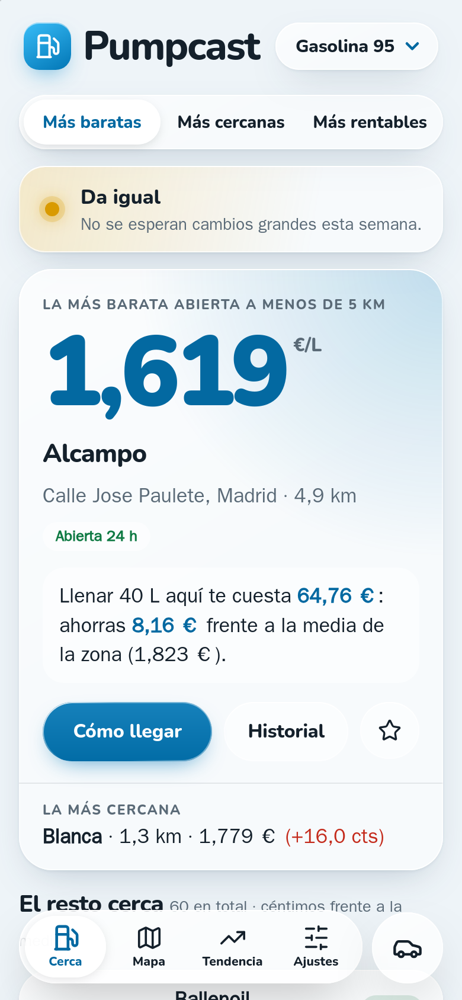
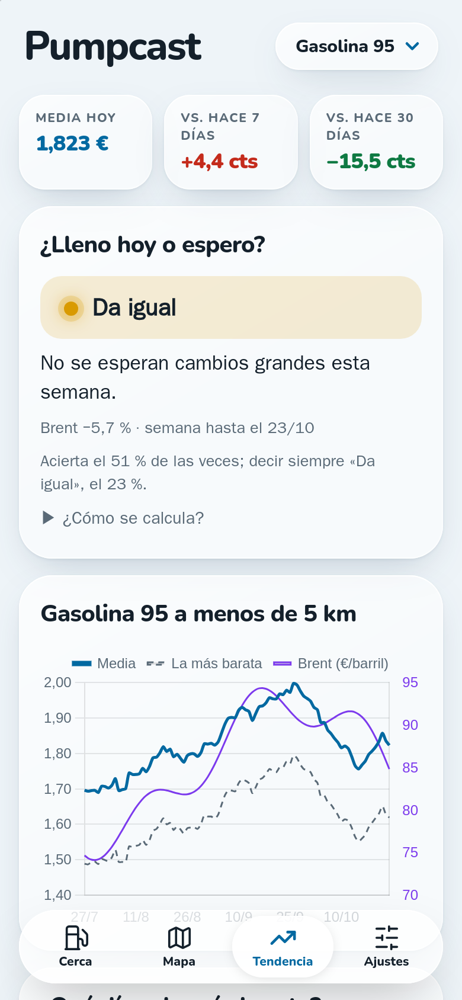
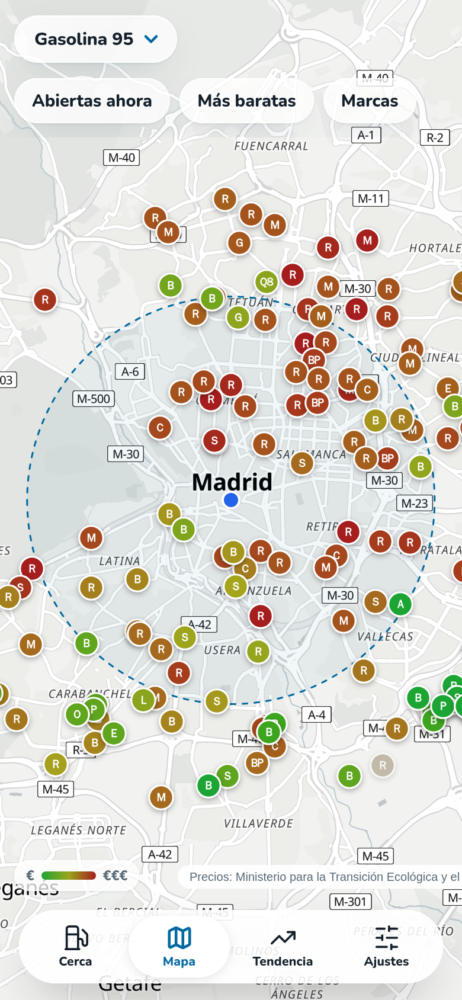
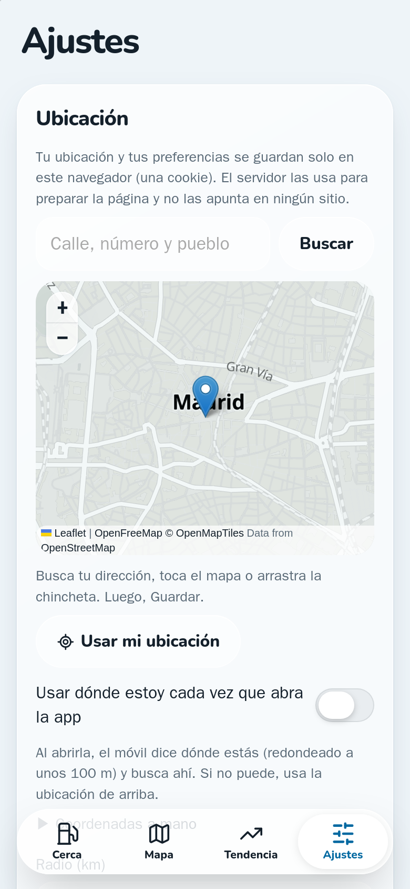
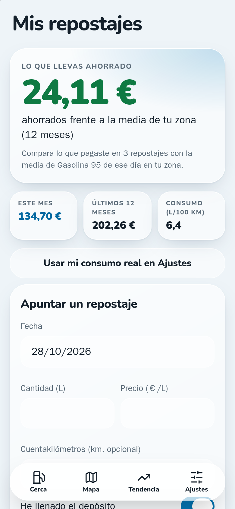
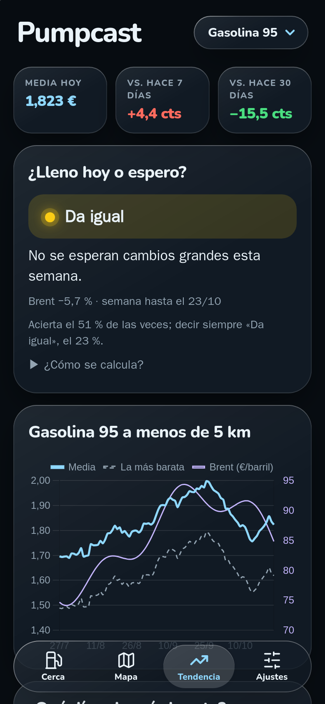

# Pumpcast

**Gasolineras baratas cerca de ti y si sale a cuenta llenar hoy.** ⛽ 🇪🇸

[](https://github.com/GodoHZ/pumpcast/actions/workflows/tests.yml)
[](LICENSE)

[English](README.md) · **Español**

App web que encuentra las **gasolineras más baratas cerca de ti, en cualquier punto de
España**, guarda su histórico de precios y te dice si **sale a cuenta llenar hoy o esperar** unos
días. Un contenedor, un fichero SQLite, sin cuentas, sin claves de API y sin rastreo. Úsala solo
para ti o ábrela a todo el mundo: la ubicación de cada visitante se queda en su navegador.

Usa los precios oficiales que toda gasolinera de España tiene que comunicar al Ministerio,
actualizados cada 30 minutos.

| Cerca | ¿Lleno o espero? | Mapa | Ajustes |
|---|---|---|---|
|  |  |  |  |
| **Mis repostajes** | **Tendencia, en oscuro** | | |
|  |  | | |

## Qué hace

- **Cerca**: la más barata *abierta ahora* dentro de tu radio (según el horario que publica cada
  gasolinera), lo que te cuesta tu repostaje habitual, cuánto ahorras frente a la media de la zona y la
  más cercana por si no compensa ir más lejos. El resto, ordenadas por precio, por distancia o por **lo que
  compensa** (contando el combustible de ir y volver). *Cómo llegar* te deja elegir Google Maps, Apple
  Maps o Waze.
- **Favoritas**: marca tus gasolineras de siempre y salen arriba, con su precio de hoy y un aviso
  cuando alguna se mueve («Ballenoil ha bajado 2,0 cts en 2 días»). Se guardan en tu navegador.
- **¿Lleno hoy o espero?** Un semáforo a 7 días (🟢 llena ya · 🟡 da igual · 🔴 espera si
  puedes), aprendido con un año de precios de *tu* provincia: el surtidor va detrás del gasóleo
  y la gasolina al por mayor, sube antes de lo que baja y los precios tienen inercia. Se **prueba con los últimos 60 días sin usarlos para aprender**
  y apunta cada previsión, así que en pantalla ves cuánto acierta de verdad.
- **Tendencia**: media y precio más barato de cada día con el Brent encima, cambio a 7 y 30
  días, qué día de la semana suele salir más barato y **qué marcas salen más baratas o más caras**
  en tu zona.
- **Mapa** de las gasolineras de alrededor sobre [OpenFreeMap](https://openfreemap.org): cada una con
  la inicial de su marca (sin logos) y su precio, del color de lo barata o cara que es: de verde a rojo.
  Se filtra por *abiertas ahora*, *más baratas que la media* y marcas, y tiene *Cómo llegar* desde cada una.
- **Mis repostajes**: apunta lo que echas y te dice lo que gastas al mes y al año, tu consumo real
  (que puedes pasar a Ajustes) y **lo que llevas ahorrado** frente a la media de tu zona de cada día.
  Se guarda solo en tu navegador.
- **Modo coche**: solo la mejor de alrededor en grande y un botón *Ir* enorme, para el móvil en el
  soporte. Te sigue mientras conduces y no deja que se apague la pantalla.
- **Con Siri**: «Oye Siri, gasolinera barata» abre tu app de mapas camino de la más barata abierta.
  La página *Con Siri* explica el atajo (o da uno ya hecho) y, en Android, deja la búsqueda a un toque
  desde el icono.
- **Pasar a otro móvil**: un enlace o un QR con tus ajustes, favoritas y repostajes, sin cuentas; los
  datos van detrás del `#`, que nunca llega al servidor.
- **Ficha de cada gasolinera**: si está abierta, su horario, 90 días de precios frente a la media de
  la zona y un botón para compartirla.
- **Avisos por Telegram** para el dueño (opcionales): un resumen cada mañana y un aviso cuando
  una cercana baja bastante de su media de 30 días, desde un panel con contraseña y verificación
  en dos pasos.
- **Fácil de usar**: busca tu dirección, toca el mapa o usa el GPS. Tu ubicación se guarda en una
  cookie de tu navegador; el servidor no la apunta. ¿De viaje? Activa *usar dónde estoy* y busca
  a tu alrededor cada vez que la abras (redondeado a unos 100 m).
- **Instalable como app (PWA)**: añádela a la pantalla de inicio; se abre a pantalla completa
  y, sin conexión, enseña lo último que vio.
- **En castellano, catalán/valenciano, gallego, euskera, aranés e inglés**, según el navegador o lo
  que elijas en Ajustes.

### ¿Cuánto acierta la previsión?

Sinceramente: es una pista, no una bola de cristal. Probada en las 52 provincias, reentrenando
cada 15 días durante 150 y midiendo solo días que no había visto, acierta **el 57 % de las veces
en gasolina 95 y el 60 % en diésel**, frente al 54 % y el 50 % de suponer que el precio no
cambia. Lo más útil es cuando avisa de un cambio: entonces acierta si sube o baja **el 88 % de
las veces en gasolina y el 78 % en diésel**. La página de Tendencia enseña las dos cifras, la
suya y la de «no cambia», para tu provincia. 2026 ha sido un año loco para los carburantes, con saltos que no tenían nada que ver
con el petróleo, y ningún modelo ve venir guerras, cambios de impuestos ni puentes. Por eso
la app enseña su propio marcador en vez de pedirte que te fíes.

El modelo es sencillo a propósito y vive en `app/prediccion.py`:

```
cambio en 7 días = a + b · (lo que subió el mercado la última semana) + c · (lo que bajó)
                     + d · (lo que se movió el precio de la provincia la última semana)
```

«El mercado» es el gasóleo o la gasolina al por mayor de Nueva York, en euros por litro, para
el diésel y las gasolinas, y el Brent para los gases. Seguir el combustible ya refinado en vez
del crudo, y separar subidas de bajadas, mejoró al modelo anterior (que solo miraba el Brent)
en las dos cifras. Otras ideas que se probaron y no mejoraban: juntar Brent y producto, mirar
dos semanas atrás, el margen de la gasolinera y buscar el retraso exacto. El día de la semana
no sirve a 7 días: de un lunes al siguiente es el mismo día.

## Puesta en marcha

```bash
git clone https://github.com/GodoHZ/pumpcast.git && cd pumpcast
docker compose up -d --build
```

Abre `http://127.0.0.1:8098`, entra en **Ajustes**, busca tu dirección y guarda. Los precios de
toda España (unas 11.000 gasolineras) llegan en un minuto. Por detrás, la app descarga un año de
histórico, un día por minuto para no agobiar al servidor del Ministerio (unas 6 horas); la
previsión aparece cuando hay unos 100 días.

El contenedor corre como el usuario `1000:1000` y escribe en `./data`. Si el tuyo es otro,
cambia la línea `user:` del `docker-compose.yml` por lo que diga `id -u`.

Para actualizar: `git pull && docker compose up -d --build`.

### Configuración

Cada visitante elige su ubicación y sus preferencias en **Ajustes**. El contenedor admite unas pocas variables:

| Variable | Para qué | Por defecto |
|---|---|---|
| `TZ` | zona horaria (la usa el resumen de la mañana) | `Europe/Madrid` |
| `ADMIN_PASSWORD_HASH` | activa el panel de administración en `/admin` (ver abajo) | apagado |
| `TITULAR`, `CONTACTO` | quién responde de la web y un correo o URL de contacto, para el aviso legal | incidencias de GitHub |
| `ATAJO_ICLOUD`, `ATAJO_COMBUSTIBLE`, `ATAJO_MAPA` | un atajo de Siri ya hecho, compartido desde iCloud, para ofrecerlo en *Con Siri*, y con qué combustible y app de mapas viene. Apunta a tu web, así que cada instalación hace el suyo | ninguno, `g95`, `waze` |
| `COPIAS_DIR`, `DIAS_DE_COPIAS` | copia diaria de la base de datos en esa carpeta, guardando esos días. La carpeta tiene que tener un fichero `.pumpcast-copias`, para no escribir nunca en un disco sin montar | apagada, `14` |
| `TELEGRAM_TOKEN`, `TELEGRAM_CHAT` | avisos por Telegram | apagados |
| `TELEGRAM_THREAD` | id del tema, si `TELEGRAM_CHAT` es un grupo con temas | — |
| `APP_URL` | enlace que se añade al final de cada aviso | ninguno |
| `DATA_DIR` | dónde vive `pumpcast.db` | `/app/data` |

**Telegram**: crea un bot con [@BotFather](https://t.me/BotFather), escríbele cualquier cosa y
abre `https://api.telegram.org/bot<TOKEN>/getUpdates` para ver tu chat id.

**Panel de administración** (donde se configuran los avisos de Telegram): genera el hash de una
contraseña larga y ponlo en `ADMIN_PASSWORD_HASH`:

```bash
docker compose run --rm -T pumpcast python -m app.seguridad hash    # escribe la contraseña y copia la línea
```

La primera vez que entres en `/admin` te pedirá añadir la **verificación en dos pasos** a tu app
de autenticación (Google Authenticator, Aegis, 1Password...). Si pierdes el móvil:
`docker compose exec pumpcast python -m app.seguridad quitar-2fa` y vuelves a darla de alta.

### Seguridad

Está hecha para poder ponerla en internet:

- **Ningún dato de los visitantes en el servidor.** La ubicación y las preferencias de cada uno van
  en una cookie de su navegador, y el buscador de direcciones va de su navegador a OpenStreetMap.
  Sin registro de visitas (uvicorn va con `--no-access-log`); lo que llega de internet se manda
  siempre a https.
- **Los visitantes no pueden disparar nada pesado.** Solo la tarea de fondo habla con el Ministerio
  (cada 30 minutos, entre quien entre). Hay un límite de peticiones por IP.
- **Cabeceras estrictas**: Content-Security-Policy con un nonce por petición, `frame-ancestors
  'none'`, `nosniff` y HSTS con HTTPS. Los formularios enviados desde otras webs se rechazan (CSRF).
- **Panel de administración**: contraseña con hash scrypt, verificación en dos pasos TOTP (cada
  código sirve una vez), bloqueo tras varios fallos y sesiones en memoria (`HttpOnly`,
  `SameSite=Strict`). **No existe para lo que entra por Cloudflare** (lleva `CF-Connecting-IP`):
  si la publicas con un [túnel de Cloudflare](https://developers.cloudflare.com/cloudflare-one/connections/connect-networks/),
  al panel solo se llega desde tu red o tu VPN. No abras puertos del router directamente hacia ella.
- **Contenedor endurecido** en `docker-compose.yml`: sistema de ficheros de solo lectura, sin
  capacidades, `no-new-privileges` y límites de memoria y procesos. Las dependencias van fijadas.

## De dónde salen los datos

| Dato | Fuente |
|---|---|
| Precios, de hoy y de días pasados | [Geoportal de carburantes](https://geoportalgasolineras.es), Ministerio para la Transición Ecológica (API REST pública) |
| Brent, gasóleo y gasolina al por mayor | FRED: [Brent](https://fred.stlouisfed.org/series/DCOILBRENTEU), [gasóleo](https://fred.stlouisfed.org/series/DDFUELNYH) y [gasolina](https://fred.stlouisfed.org/series/DGASNYH) de Nueva York (datos de la EIA de EE. UU., dominio público) |
| Euro/dólar | [Banco Central Europeo](https://data.ecb.europa.eu) |
| Buscador de direcciones y mapa | [OpenStreetMap](https://www.openstreetmap.org/copyright) (Nominatim) |

FRED publica estas series con cerca de una semana de retraso, así que la previsión aprende y
prevé con lo que de verdad se conocía cada día. Todas las páginas citan al Ministerio como fuente
y enlazan a un aviso legal y de privacidad (`/legal`). El servidor del Ministerio solo habla un cifrado TLS antiguo
(AES256-GCM-SHA384), que la app activa solo para ese servidor.

## Cómo está hecha

Python 3.12, FastAPI y SQLite, plantillas Jinja2, Chart.js, Leaflet y la letra Nunito
(incluidos, para que funcione sin conexión y no pregunte a terceros). Aspecto de cristal líquido con
CSS a secas, que se vuelve sólido con *Reducir transparencia*. Sin compilar nada: no hay npm ni bundler.

```
app/
  main.py        rutas web y arranque          i18n.py      textos (idiomas/: las otras lenguas)
  seguridad.py   cabeceras, límites y panel    preferencias.py  la cookie de cada visitante
  minetur.py     precios del Ministerio        mercado.py   Brent, gasóleo, gasolina y euro/dólar
  prediccion.py  la previsión a 7 días         avisos.py    avisos por Telegram
  repo.py        consultas SQL                 db.py        esquema
  tareas.py      tarea de fondo: lecturas, histórico y avisos
  horario.py     si está abierta ahora         marcas.py    distintivos de marca del mapa
  templates/     pantallas y service worker    static/      CSS, JS, iconos y librerías
tests/           pytest, se ejecutan dentro del docker build
scripts/         iconos, capturas con WebKit, despliegue en Portainer, hook de git
```

Los **tests se ejecutan durante `docker build`**: si falla uno, no se genera la imagen.

```bash
docker build --target test -t pumpcast-test .                  # solo los tests
docker build -f scripts/capturas/Dockerfile --target export \
  --output type=local,dest=/tmp/capturas .                        # capturas a tamaño iPhone
```

Si vas a tocar el código en tu copia, hay un hook que impide commitear datos privados
(rutas, dominios, `.db`, configuración local): `git config core.hooksPath scripts/git-hooks`.
La lista de patrones se lee de `~/.config/pumpcast/patrones-privados.txt`.

Se aceptan issues y pull requests, sobre todo idiomas nuevos: añade un fichero en
`app/idiomas/` y los tests comprueban que no falte ningún texto.

## Licencia

[MIT](LICENSE). Sin relación con el Ministerio ni con ninguna marca de carburantes.
