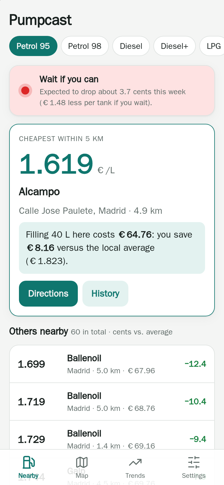
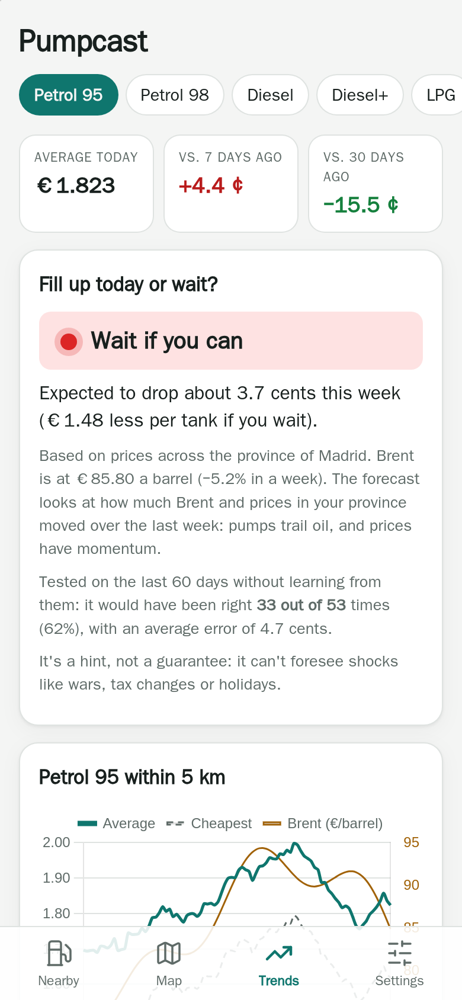
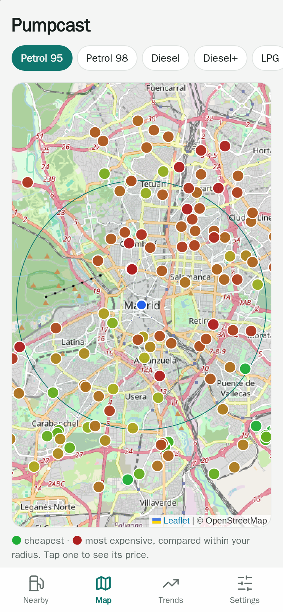
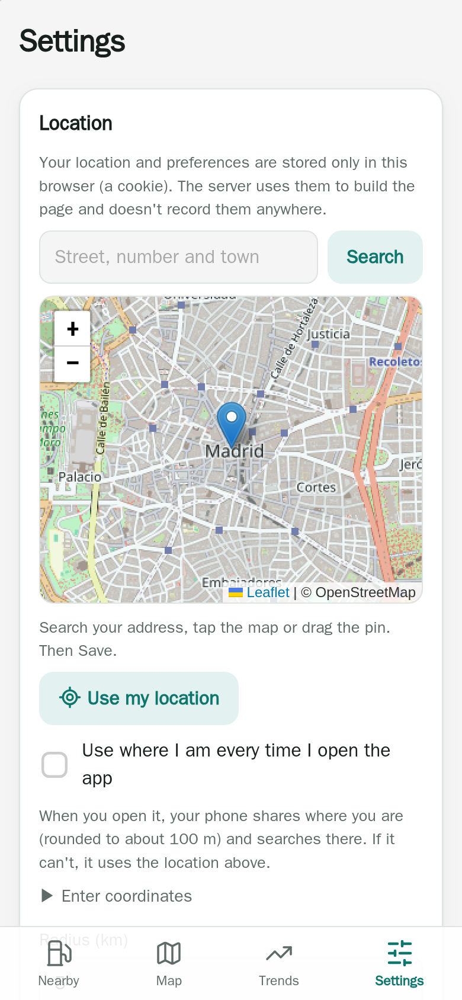

# Pumpcast

**Cheap fuel near you, and whether to fill up today.** ⛽ 🇪🇸

[](https://github.com/GodoHZ/pumpcast/actions/workflows/tests.yml)
[](LICENSE)

**English** · [Español](README.es.md)

A web app that finds the **cheapest petrol stations near you, anywhere in Spain**, keeps their
price history and tells you whether it's worth **filling up today or waiting** a few days. One
container, one SQLite file, no accounts, no API keys, no tracking. Run it just for yourself or
open it to everyone: each visitor's location stays in their own browser.

It uses the official prices that every station in Spain must report to the Ministry, refreshed
every 30 minutes.

| Nearby | Fill up or wait? | Map | Settings |
|---|---|---|---|
|  |  |  |  |

## What it does

- **Nearby**: the cheapest station within your radius, what your usual fill-up costs there,
  how much you save compared with the local average, and the rest sorted by price, with a *Directions* button.
- **Fill up today or wait?** A 7-day traffic light (🟢 fill up now · 🟡 no rush · 🔴 wait if
  you can), learnt from a year of prices in *your* province: pumps trail Brent crude, and
  prices have momentum. It is **tested on the last 60 days without learning from them** and logs
  every forecast, so the screen shows how often it actually gets it right.
- **Trends**: local average and cheapest price per day with Brent on top, change over
  7 and 30 days, and which day of the week tends to be cheapest.
- **Map** of the stations around you, from green (cheap) to red (expensive).
- **Station history**: 90 days of prices against the local average.
- **Telegram alerts** for the owner (optional): a morning summary and a heads-up when a station
  near you drops well below its 30-day average, set up from a password + two-step protected panel.
- **Easy setup**: search your address, tap the map or use GPS. Your location is kept in a cookie
  in your browser; the server never records it. Travelling? Turn on *use where I am* and it
  searches around you every time you open it (rounded to ~100 m).
- **Installable app (PWA)**: add it to your home screen; it opens full screen and shows the
  last data it saw when you're offline.
- **English and Spanish**, following your browser or chosen in Settings.

### How good is the forecast?

Honestly: a hint, not a crystal ball. With a year of real prices from one province, over 60
days it had never seen, it was right about **6 times out of 10** for both petrol and diesel,
against 4–5 out of 10 for simply assuming prices won't change. 2026 was a wild year for fuel,
with jumps that had nothing to do with oil, and no model sees wars, tax changes or bank
holidays coming. That's why the app shows its own track record instead of asking you to
trust it.

The model is deliberately simple and lives in `app/prediccion.py`:

```
change in 7 days = a + b · (Brent in € over the last week) + c · (province price over the last week)
```

A fancier version that looked for the exact lag behind Brent did no better than "no change",
so it was dropped.

## Quick start

```bash
git clone https://github.com/GodoHZ/pumpcast.git && cd pumpcast
docker compose up -d --build
```

Open `http://127.0.0.1:8098`, go to **Settings**, search your address and save. Prices for all
of Spain (about 11,000 stations) arrive within a minute. In the background the app downloads a
year of history, one day per minute so as not to strain the Ministry's server (about 6 hours);
the forecast appears once it has about 100 days.

The container runs as user `1000:1000` and writes to `./data`. If your user is different,
change the `user:` line in `docker-compose.yml` to what `id -u` says.

To update: `git pull && docker compose up -d --build`.

### Configuration

Each visitor sets their location and preferences in **Settings**. The container takes a few variables:

| Variable | What for | Default |
|---|---|---|
| `TZ` | time zone (the morning summary uses it) | `Europe/Madrid` |
| `ADMIN_PASSWORD_HASH` | turns on the admin panel at `/admin` (see below) | off |
| `TITULAR`, `CONTACTO` | who runs the site and a contact email or URL, for the legal notice | GitHub issues |
| `TELEGRAM_TOKEN`, `TELEGRAM_CHAT` | Telegram alerts | off |
| `TELEGRAM_THREAD` | topic id, if `TELEGRAM_CHAT` is a group with topics | — |
| `APP_URL` | link added at the end of each alert | none |
| `DATA_DIR` | where `pumpcast.db` lives | `/app/data` |

**Telegram**: create a bot with [@BotFather](https://t.me/BotFather), send it any message and
open `https://api.telegram.org/bot<TOKEN>/getUpdates` to find your chat id.

**Admin panel** (where the Telegram alerts are set up): generate the hash of a long password
and put it in `ADMIN_PASSWORD_HASH`:

```bash
docker compose run --rm -T pumpcast python -m app.seguridad hash    # type the password, copy the line
```

The first time you sign in at `/admin` it asks you to add **two-step verification** to your
authenticator app (Google Authenticator, Aegis, 1Password...). If you lose the phone:
`docker compose exec pumpcast python -m app.seguridad quitar-2fa` and enrol again.

### Security

It's built to be put on the internet:

- **No visitor data on the server.** Each visitor's location and preferences live in a cookie
  in their browser; the address search goes from their browser straight to OpenStreetMap.
  No access logs (uvicorn runs with `--no-access-log`); requests from the internet are always
  redirected to https.
- **Visitors can't trigger anything heavy.** Only the background job talks to the Ministry (every
  30 minutes, however many people visit). There is a per-IP rate limit.
- **Strict headers**: a Content-Security-Policy with a per-request nonce, `frame-ancestors 'none'`,
  `nosniff`, HSTS over HTTPS. Forms from other sites are rejected (CSRF).
- **Admin panel**: scrypt-hashed password, TOTP two-step verification (codes can't be reused),
  lockout after repeated failures, in-memory sessions (`HttpOnly`, `SameSite=Strict`). It **doesn't
  exist for requests coming through Cloudflare** (they carry `CF-Connecting-IP`), so if you publish
  it with a [Cloudflare Tunnel](https://developers.cloudflare.com/cloudflare-one/connections/connect-networks/)
  the panel is only reachable from your own network or VPN. Don't open router ports to it directly.
- **Hardened container** in `docker-compose.yml`: read-only filesystem, no capabilities,
  `no-new-privileges`, memory and process limits. Dependencies are pinned.

## Where the data comes from

| Data | Source |
|---|---|
| Prices, today and past days | [Geoportal de carburantes](https://geoportalgasolineras.es), Spanish Ministry for the Ecological Transition (public REST API) |
| Brent crude | [FRED](https://fred.stlouisfed.org/series/DCOILBRENTEU) (U.S. EIA data, public domain) |
| EUR/USD | [European Central Bank](https://data.ecb.europa.eu) |
| Address search, map tiles | [OpenStreetMap](https://www.openstreetmap.org/copyright) (Nominatim) |

FRED publishes Brent about a week late, so the forecast learns and predicts with the Brent
that was actually published on each day. Every page credits the Ministry as its source and
links to a legal notice and privacy page (`/legal`). The Ministry's server only speaks an old TLS cipher
(AES256-GCM-SHA384), which the app enables for that server alone.

## How it's built

Python 3.12, FastAPI and SQLite, Jinja2 templates, Chart.js and Leaflet (bundled, so it works
offline). Nothing to compile: no npm, no bundler.

```
app/
  main.py        web routes and startup        i18n.py      English and Spanish texts
  seguridad.py   headers, rate limit, admin    preferencias.py  each visitor's cookie
  minetur.py     Ministry prices               mercado.py   Brent and EUR/USD
  prediccion.py  the 7-day forecast            avisos.py    Telegram alerts
  repo.py        SQL queries                   db.py        schema
  tareas.py      background job: reads, history and alerts
  templates/     pages and service worker      static/      CSS, JS, icons, bundled libraries
tests/           pytest, run inside docker build
scripts/         icons, screenshots with WebKit, Portainer deploy, git hook
```

The code and its comments are in Spanish (it's a personal project); the interface is
in both languages. **Tests run during `docker build`**: if one fails, no image is produced.

```bash
docker build --target test -t pumpcast-test .                  # tests only
docker build -f scripts/capturas/Dockerfile --target export \
  --output type=local,dest=/tmp/capturas .                        # screenshots at iPhone size
```

Issues and pull requests are welcome, especially new languages: add a block to `app/i18n.py`
and the tests check that no text is missing.

## License

[MIT](LICENSE). Not affiliated with the Spanish Ministry or any fuel brand.
